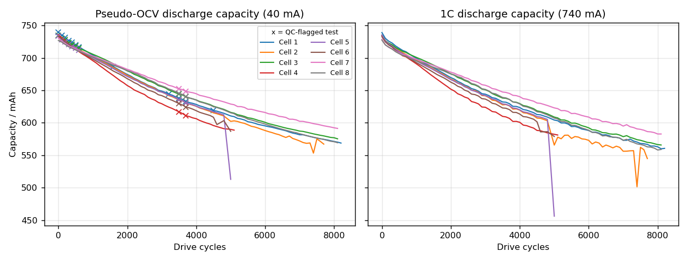
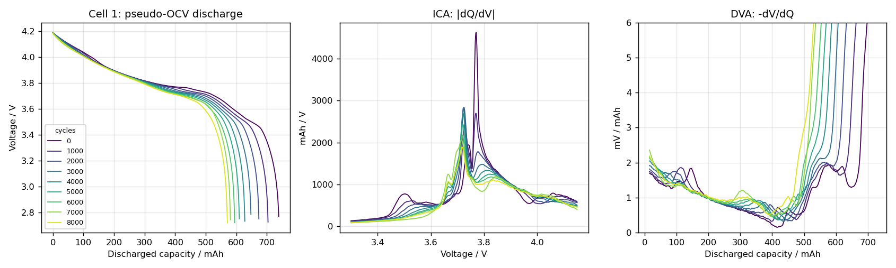
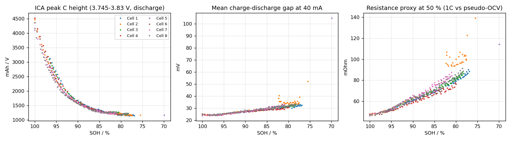

# battery-degradation-modes

Degradation-mode analysis of lithium-ion cells from low-rate charge/discharge curves, with a physics-based
open-circuit-voltage model underneath and machine learning on top.

> 한국어 요약: 저율속 충방전 곡선에서 열화를 리튬 손실(LLI)과 양극·음극 활물질 손실(LAM)로 분해하고,
> 비이상 열역학 기반 OCV 모델과 ML 추정기를 붙이는 개인 프로젝트입니다. 지금은 **1단계 이전의 데이터 준비**까지
> 되어 있습니다. 공개 데이터(Oxford Battery Degradation Dataset 1)를 표 형태로 바꾸고, 품질 점검과 dQ/dV 특징량을 만들었습니다.

## Status (2026-11-18)

| Step | What | State |
|---|---|---|
| 0 | Convert the Oxford dataset to tidy CSV/Excel, quality check, capacity fade, ICA/DVA features | **done** (this commit) |
| 1 | Degradation-mode baseline: fit half-cell OCVs to the pseudo-OCV curves -> LLI, LAM_PE, LAM_NE | not started |
| 2 | Thermodynamic OCV model (non-ideal chemical potential) replacing table look-up | not started |
| 3 | Synthetic curves from the model -> ML estimator of LLI/LAM from partial curves (group k-fold by cell) | not started |
| 4 | Apply to measured data from a battery-diagnostics course | not started |

Nothing in this repository estimates degradation modes yet. Step 0 only re-formats and describes public data.

## Data

**Oxford Battery Degradation Dataset 1** - 8 Kokam SLPB533459H4 pouch cells (740 mAh), aged at 40 degC with a CC-CV charge and an
Artemis-urban drive-cycle discharge. Every 100 drive cycles a 1C cycle (740 mA) and a pseudo-OCV cycle (40 mA, about C/18.5) were recorded.

- Birkl, C. & Howey, D. (2017). *Oxford Battery Degradation Dataset 1*. University of Oxford. DOI [10.5287/bodleian:KO2kdmYGg](https://dx.doi.org/10.5287/bodleian:KO2kdmYGg)
- C. R. Birkl, *Diagnosis and Prognosis of Degradation in Lithium-Ion Batteries*, PhD thesis, University of Oxford, 2017.
- Record: <https://ora.ox.ac.uk/objects/uuid:03ba4b01-cfed-46d3-9b1a-7d4a7bdf6fac>

The raw `.mat` file (254 MB) is not stored here. Download it from the record above into `data/raw/`.
SHA-256 of the file used: `a8f0b928f4ea77d7ba98b97194b78cc77336f2338fee8b57573d043f0cf26781`.

Files in `data/processed/` are derived from that database and are shared under the same licence (see `data/README.md`).

| File | Content |
|---|---|
| `summary.csv` | one row per cell x cycle x test: capacity, duration, mean current, temperature, QC note (2076 rows) |
| `features.csv` | one row per cell x cycle: capacities, SOH, capacity inside fixed voltage windows, ICA peak heights/positions, mean charge-discharge gap, resistance proxy (519 rows) |
| `ocv_curves_1mAh.csv.gz` | pseudo-OCV charge and discharge, voltage and temperature on a 1 mAh grid |
| `c1_curves_1mAh.csv.gz` | 1C charge and discharge on the same grid |
| `ica_curves_5mV.csv.gz` | dQ/dV of the pseudo-OCV curves on a 5 mV grid (3.30-4.15 V) |
| `oxford_dataset1_processed.xlsx` | the same tables in one workbook, plus one sheet per cell with V(Q) for every characterisation |

## Reproduce

```bash
pip install -r requirements.txt
python scripts/01_convert_oxford.py data/raw/Oxford_Battery_Degradation_Dataset_1.mat data/processed
python scripts/02_capacity_ica.py data/processed figures
python scripts/03_verify_against_raw.py data/raw/Oxford_Battery_Degradation_Dataset_1.mat data/processed
python scripts/04_build_excel.py data/processed data/processed/oxford_dataset1_processed.xlsx
```

`03_verify_against_raw.py` re-reads 96 randomly chosen tests from the raw file: capacities agree to 0.0005 mAh and the 1 mAh grid
reproduces the raw voltage to within 2.4 mV (excluding the first and last 2 mAh, where the curve is steep).

## What the data look like



Pseudo-OCV discharge capacity falls from 727-740 mAh to about 570-590 mAh over 8000 drive cycles (SOH about 0.77-0.81 for the
cells that ran that long). Cells 4, 5 and 6 stop near 5000 cycles; cell 5 drops sharply at its last point.



For cell 1 the sharp ICA peak near 3.77 V and the low-voltage feature near 3.5 V shrink with ageing. These are the features a
degradation-mode fit has to explain; they are not assigned to an electrode here.



## Things found while converting

1. The time vector in the `.mat` file is a MATLAB datenum in **days**, not seconds as the readme states.
2. Pseudo-OCV tests at cycle 3500 (charge) and 3700 (charge and discharge) ran at about **24-25 degC instead of 40 degC** for all cells.
3. Cell 1, cycle 1600: the temperature channel reads about 0.5 degC (sensor fault).
4. Cell 1, cycles 3200 and 4500: the pseudo-OCV tests contain a long pause (duration ~183 h); the V-Q curves are still usable.
5. Cells 1, 3, 5, cycles 0-600: the mean pseudo-OCV current computed from q and t is ~42 mA on charge and ~38 mA on discharge.
6. Cell 2 shows a capacity jump of +22 mAh at cycle 7500.

All of these are written to the `qc` column of `summary.csv`, so later steps can exclude them.

## Known gaps before step 1

- **Half-cell OCV curves for this cell are not in the dataset.** A degradation-mode fit needs them. Options: digitise the half-cell
  curves from the related publications, or infer the positive-electrode curve from the fresh full cell with a literature graphite curve.
  Either choice has to be stated next to every result.
- 40 mA is about C/18.5, so the curves still contain some polarisation (mean charge-discharge gap about 24-33 mV for 90 % of the tests).
- The voltage windows used for the features were chosen by eye from the fresh-cell ICA curve.

## Licence

Code: MIT (see `LICENSE`). Data in `data/processed/`: Open Database License 1.0 (see `data/README.md`).

The step-0 scripts were drafted with an AI coding assistant and checked against the raw file with `scripts/03_verify_against_raw.py`.
